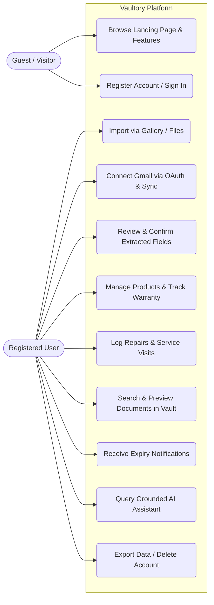
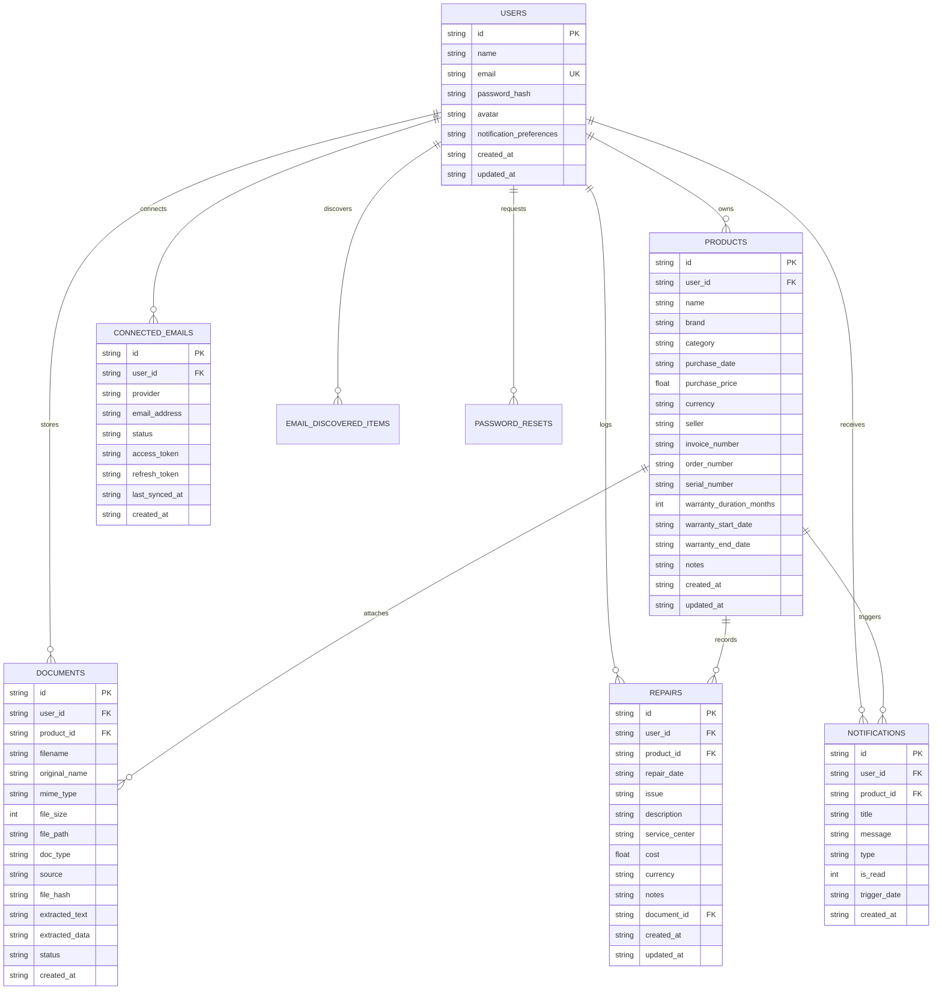
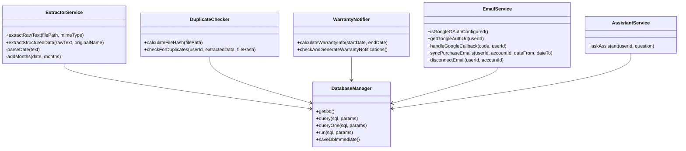
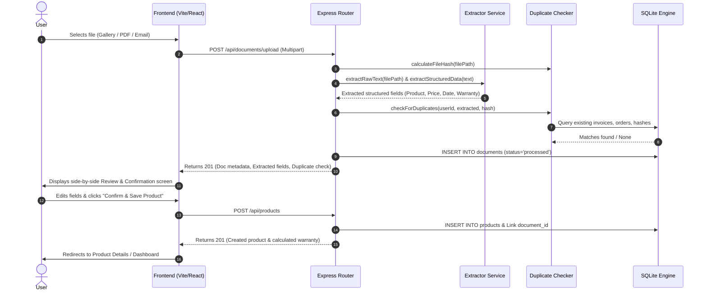
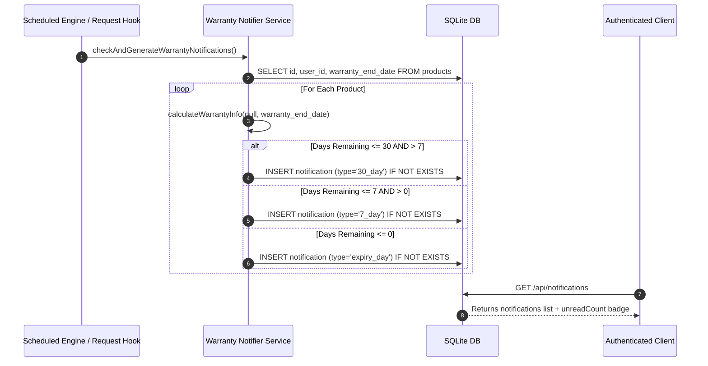
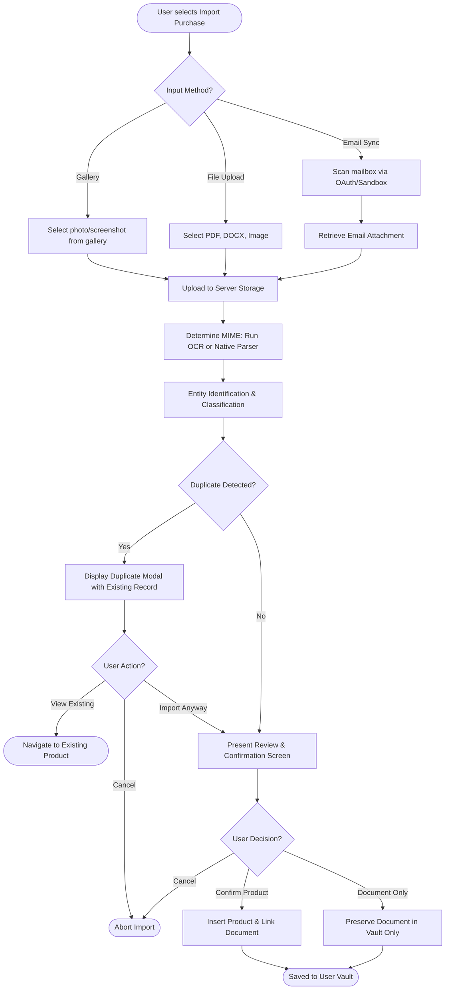

# Vaultory — Software Engineering Specification & Architecture Report

> **Product:** Vaultory  
> **Tagline:** Every Purchase. Every Warranty. One Place.  
> **Course / Category:** Software Engineering Capstone Project / Full-Stack System Design  
> **Platform Version:** 1.0.0 Production  

---

## 1. Executive Summary & Problem Statement

### 1.1 Problem Statement
Modern consumers make numerous significant purchases annually across electronics, home appliances, computing equipment, furniture, and vehicles. However, the documentation associated with these transactions—such as tax invoices, payment receipts, warranty cards, repair receipts, and order confirmations—is fragmented across paper shoeboxes, disparate email accounts (Gmail, Outlook, iCloud), physical folders, and unsorted local download folders.

Consequently:
1. **Lost Purchase Invoices:** When equipment fails, owners cannot quickly locate receipts required by manufacturers or credit card insurance providers to honor warranty or claim services.
2. **Expired Warranties & Missed Deadlines:** Warranties expire silently without user awareness. Consumers miss the crucial 30-day and 7-day windows to repair defective hardware free of charge or renew extended coverage.
3. **No Central Product Lifecycle History:** Consumers lack unified visibility into their total cost of ownership (initial purchase price vs. cumulative repair and maintenance expenses).
4. **Scattered Multi-Device Records:** A receipt stored on a home desktop cannot be readily accessed from a smartphone at a service center or retail return desk.

### 1.2 Project Objectives
Vaultory is engineered as a secure, full-stack personal purchase-document vault and product lifecycle management platform. The application provides:
- **Unified Document Ingestion:** Import invoices, bills, and receipts via three channels: device photo gallery (screenshots/photos), native files (PDF, DOCX, scanned documents), or email discovery (OAuth 2.0 Gmail integration).
- **Intelligent Structured Extraction & OCR:** High-accuracy extraction using native parsing (`pdf-parse`, `mammoth`) and OCR (`tesseract.js`) coupled with structured entity recognition for brands, prices, dates, serial numbers, retailers, and warranty terms.
- **Dynamic Warranty Intelligence:** Real-time calculation of warranty statuses (Active, Expiring Soon $\le 30$ days, Expired, Unknown) and dynamic integer countdowns without hardcoded dates.
- **In-App Proactive Notifications:** Notification triggers at 30 days, 7 days, and on expiration day with duplicate suppression.
- **Service & Repair Ledger:** Maintenance tracking linked to products and receipts, calculating total cost of ownership.
- **Grounded AI Intelligence Assistant:** User-scoped, data-grounded assistant that answers natural language queries about purchases, warranties, and expenses without arbitrary SQL execution risks.
- **Cross-Device Central Persistence:** Zero reliance on ephemeral local storage; full relational SQLite persistence, parameterized security, and user-level data isolation.

---

## 2. Requirements Engineering

### 2.1 Functional Requirements (FR)

| ID | Requirement Description | Priority |
| :--- | :--- | :--- |
| **FR-01** | **User Account & Identity:** User registration, password hashing (bcrypt), JWT issuance, profile updates, and secure account deletion. | High |
| **FR-02** | **Password Recovery:** Tokenized password reset mechanism allowing users to generate recovery codes and update passwords. | High |
| **FR-03** | **Gallery Ingestion (Option A):** Image file selector for device photos, mobile camera library, multi-image preview, and OCR extraction. | High |
| **FR-04** | **File Ingestion (Option B):** Drag-and-drop file upload supporting PDF, DOCX, DOC, JPG, PNG, WebP up to 15MB with progress feedback. | High |
| **FR-05** | **Email Document Discovery (Option C):** Google OAuth 2.0 connection, purchase email query filtering, date range searches, attachment retrieval, and selective import. | High |
| **FR-06** | **Unified Processing Pipeline:** 7-stage sequential processing workflow (Upload $\rightarrow$ Read $\rightarrow$ OCR $\rightarrow$ Entity Extraction $\rightarrow$ Duplicate Check $\rightarrow$ Review Preparation $\rightarrow$ Ready). | High |
| **FR-07** | **Duplicate Detection Engine:** Computes SHA-256 file hashes, matches invoice numbers, order IDs, and matching product/date/price criteria with override options. | High |
| **FR-08** | **Review & Confirmation Screen:** Side-by-side view featuring original document visual preview alongside an editable extraction form. | High |
| **FR-09** | **Product Management (CRUD):** Cataloging products with brand, category, purchase date, price, store, serial number, and notes. | High |
| **FR-10** | **Warranty Calculations:** Real-time evaluation of coverage state (Active, Expiring Soon, Expired, Unknown) with day countdowns. | High |
| **FR-11** | **Automated Reminders:** In-app notification creation for 30-day, 7-day, and on-expiry deadlines. | High |
| **FR-12** | **Documents Vault:** Centralized repository for all uploaded files with type/source filtering, search, inline preview, and download. | High |
| **FR-13** | **Repair Ledger:** Logging repair dates, issues, costs, service centers, and calculating total cost of ownership per product. | Medium |
| **FR-14** | **Spending Analytics:** Aggregated metrics for total spend, category breakdown, monthly spend timeline, and warranty distributions. | Medium |
| **FR-15** | **Grounded AI Assistant:** Conversational query engine answering specific user questions grounded strictly in their own database records. | Medium |
| **FR-16** | **Theme Mode Toggle (Light & Dark):** Global theme provider with instant toggle across Header, Sidebar, Landing page, and Profile settings, persisted in localStorage with system preference detection. | Medium |
| **FR-17** | **Universal Invoice Quick View & In-Browser Viewer:** One-click in-app modal with authenticated PDF/Image streaming, zoom controls, formatted digital tax invoice view, and raw OCR metadata across Dashboard, Products, Vault, and Expirations. | High |

### 2.2 Non-Functional Requirements (NFR)

1. **Security & Confidentiality:** Passwords hashed with salted bcrypt (10 rounds). Authenticated API endpoints guarded by JWT bearer tokens. Strict query parameterization preventing SQL injection.
2. **Reliability & Data Isolation:** Centralized SQLite database with foreign keys and cascading integrity. No cross-tenant data leaks.
3. **Performance:** Sub-second response times for dashboard analytics; asynchronous processing for OCR and file uploads with live progress indicators.
4. **Usability & Aesthetics:** Minimalist SaaS aesthetic using deep forest green (`#1b3a32`), warm off-white (`#fbfbf9`), charcoal typography, and subtle borders. Responsive on desktop, tablets, and mobile devices.
5. **Portability:** Pure JavaScript/WebAssembly stack (`sql.js`, `tesseract.js`, `pdf-parse`) eliminating native C++ binary dependencies for cross-platform zero-friction execution.

---

## 3. System Architecture & Diagrams

### 3.1 Use Case Diagram

---

### 3.2 Entity-Relationship (ER) Diagram

---

### 3.3 Class Diagram (Core Services)

---

### 3.4 Sequence Diagram: Unified Import & Review Pipeline

---

### 3.5 Sequence Diagram: Warranty Notification & Expiration Watcher

---

### 3.6 Activity Diagram: Document Ingestion & Classification

---

## 4. REST API Documentation

All authenticated endpoints require an `Authorization: Bearer <jwt_token>` header.

### 4.1 Authentication Endpoints
- `POST /api/auth/register`: Create user account (`name`, `email`, `password`).
- `POST /api/auth/login`: Authenticate and receive signed JWT token.
- `GET /api/auth/me`: Retrieve currently authenticated user profile.
- `PUT /api/auth/profile`: Update profile attributes and notification preferences.
- `PUT /api/auth/password`: Change account password with old password verification.
- `POST /api/auth/forgot-password`: Generate a secure password reset token.
- `POST /api/auth/reset-password`: Validate reset token and establish new password.
- `DELETE /api/auth/account`: Permanently delete account, wiping all records and unlinking files on disk.

### 4.2 Product Management Endpoints
- `GET /api/products`: List user products with support for query parameters (`q`, `category`, `warranty_status`, `sort`). Dynamically injects warranty countdowns and document/repair counts.
- `GET /api/products/:id`: Fetch complete product details, associated documents, repair records, and total cost of ownership.
- `POST /api/products`: Create a product manually or confirmed from document review.
- `PUT /api/products/:id`: Update product metadata and recalculate warranty boundaries.
- `DELETE /api/products/:id`: Delete product while preserving associated documents in the Documents Vault (`product_id = NULL`).

### 4.3 Document Processing Endpoints
- `POST /api/documents/upload`: Multipart upload (max 15MB) running OCR/parsing, entity extraction, duplicate checking, and storing document records.
- `GET /api/documents`: List user documents with filters (`doc_type`, `source`, `q`).
- `GET /api/documents/details/:id`: Fetch complete document metadata, linked product information, and parsed extraction fields for Quick View modal.
- `GET /api/documents/preview/:id`: Stream file for in-browser visual preview (PDF iframe / Image) with token authentication and auto-regeneration fallback.
- `GET /api/documents/download/:id`: Trigger secure file download.
- `DELETE /api/documents/:id`: Delete document from vault and unlink file from physical storage.

### 4.4 Repair & Service Endpoints
- `GET /api/repairs`: Fetch repairs list and total expenditure summary.
- `POST /api/repairs`: Log a repair against a product (`product_id`, `repair_date`, `issue`, `cost`, `service_center`).
- `PUT /api/repairs/:id`: Update repair information.
- `DELETE /api/repairs/:id`: Delete a repair record.

### 4.5 Email Integration Endpoints
- `GET /api/email/status`: Retrieve OAuth configuration state and connected accounts.
- `GET /api/email/oauth/google/callback`: Handle OAuth redirect, exchange code for tokens.
- `POST /api/email/connect-demo`: Connect sandbox demo mailbox for immediate evaluation.
- `POST /api/email/sync`: Scan mailbox for purchase invoices within an optional date range.
- `GET /api/email/items`: Retrieve discovered purchase emails.
- `POST /api/email/import-item`: Import discovered email item into unified processing pipeline.
- `DELETE /api/email/disconnect/:id`: Revoke access and remove connected account credentials.

### 4.6 Analytics & AI Assistant Endpoints
- `GET /api/analytics/dashboard`: Compute summary KPIs, category spend charts, monthly timeline, and warranty distributions from real database records.
- `POST /api/assistant/ask`: Query grounded AI assistant about user purchases, warranties, and expenses.

---

## 5. Verification & Test Plan

### 5.1 Test Cases & Results Matrix

| Test ID | Test Scenario | Expected Outcome | Status |
| :--- | :--- | :--- | :--- |
| **TC-01** | User registration with duplicate email | Rejected with status 400 and clear error | **PASS** |
| **TC-02** | Password hashing with bcrypt | Hashes stored with salt; original plaintext never saved | **PASS** |
| **TC-03** | Digital invoice parsing (Amazon receipt) | Extracts brand (Sony), price (29,990), invoice (INV-827361), and 12-month warranty | **PASS** |
| **TC-04** | Dynamic warranty status calculation | Product with expiry $>30$ days marked Active; $\le 30$ days marked Expiring Soon; $<0$ Expired | **PASS** |
| **TC-05** | Duplicate detection (invoice & hash) | Flags duplicate invoice and order number with match details | **PASS** |
| **TC-06** | In-app notification creation | Automatically generates 30-day notice for expiring items; suppresses duplicates | **PASS** |
| **TC-07** | Repair cost accumulation | Sums repair costs into product total cost of ownership | **PASS** |
| **TC-08** | Grounded AI queries | Accurately returns expiring products, Sony items, and repair spend figures | **PASS** |
| **TC-09** | Safe document deletion | Deleting a document leaves the parent product intact | **PASS** |
| **TC-10** | Complete account erasure | Deleting account cascades to delete products, repairs, notifications, and disk files | **PASS** |
| **TC-11** | Theme Mode Switcher (Light & Dark) | Toggles `.dark` root class, updates theme state, persists selection to localStorage, adapts all UI components | **PASS** |
| **TC-12** | Universal Invoice Quick View Modal | Streams authenticated PDF/Image inline (`?token=...`), renders digital invoice view with warranty certificate, zoom controls | **PASS** |

---

## 6. Security Considerations & Future Scope

### 6.1 Security Considerations
- **No Email Passwords:** OAuth 2.0 authorization ensures passwords never touch the server.
- **Tenant Isolation:** Every SQL operation explicitly parameterizes `WHERE user_id = ?`.
- **Upload Validation:** Strict MIME-type filtering and 15MB file size limits prevent denial-of-service and malicious upload execution.
- **Sanitized SQL:** All queries use prepared statements with parameter binding; no dynamic SQL concatenation.

### 6.2 Future Scope
- **Push Notification Integration:** Web Push API for browser notifications when the tab is closed.
- **Automated Warranty Claim Filing:** Direct API integration with authorized OEM service ticketing portals.
- **Multi-Store Browser Extension:** Extension to automatically capture online invoices at the confirmation page.
